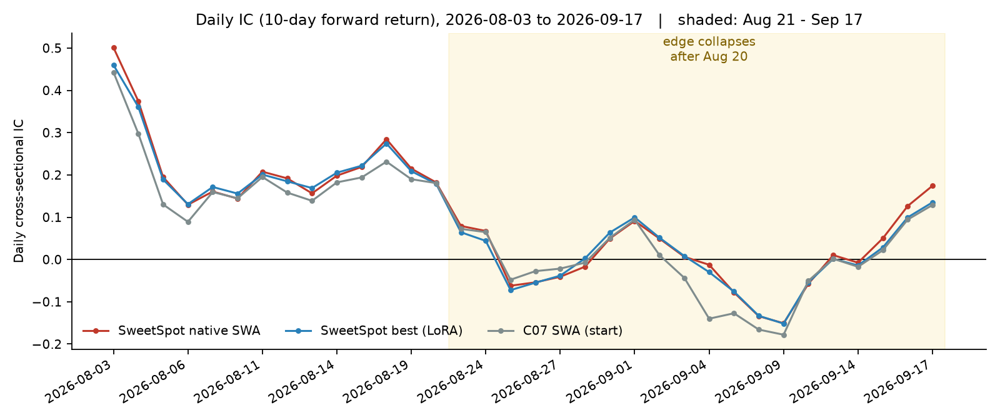
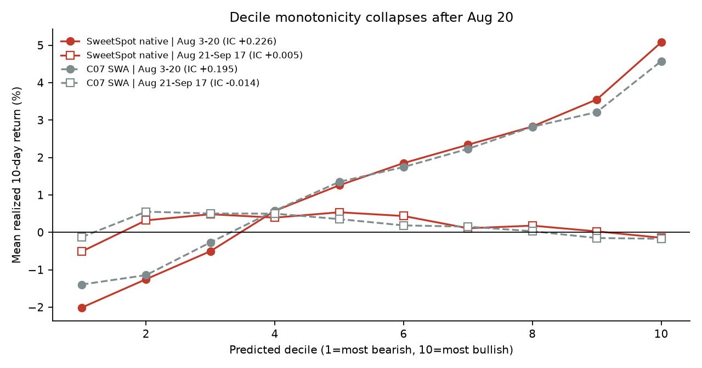
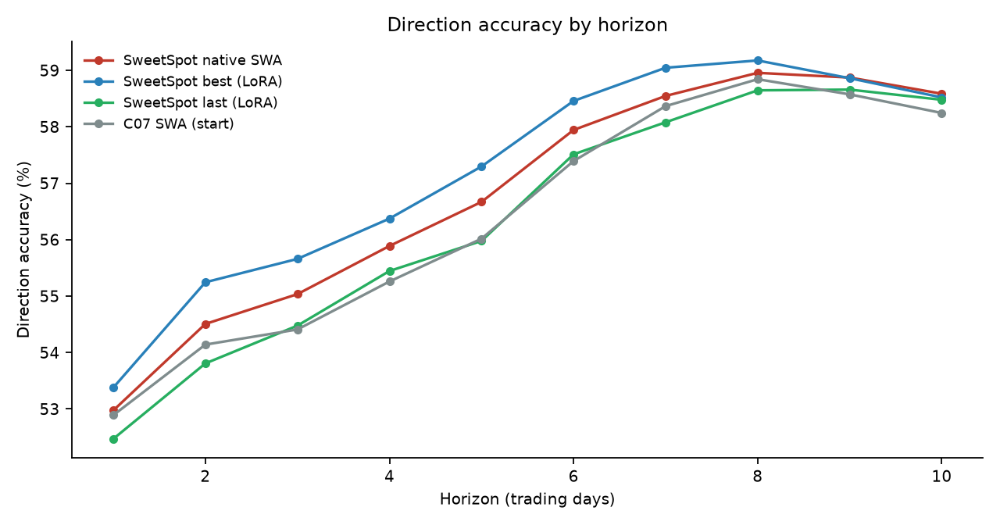
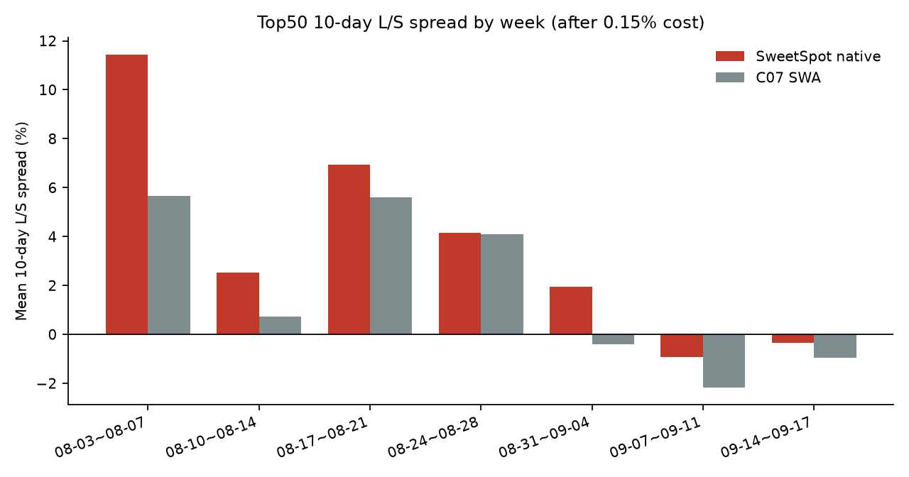

# SweetSpot 原生 SWA OOS 实测与归因分析

**评测对象**：`timesfm3_v11_sweetspot_native_merged.pt`（best+last 1:1 权重空间 SWA，烘焙进官方 TimesFM 3.0 底座，零 LoRA）  
**评测样本**：175,428 条，34 个交易日（2026-08-03 ~ 2026-09-17），标签截至 2026-10-09  
**对照模型**：C07 best / C07 last / C07 SWA native / SweetSpot best (LoRA) / SweetSpot last (LoRA)  
**数据来源**：6 个模型共用同一份 `dates/true_ret`，逐样本配对；本地 `npz` + `sweetspot_vs_c07_full_report.json`  
**归档日期**：2026-10-17

---

## 0. 一句话结论

**原生 SWA 是一个合格的工程交付物，但 OOS 的截面 alpha 高度集中在 8 月 3 日 ~ 8 月 20 日；8 月 21 日之后日均截面 IC 仅 +0.0045，Top50 多空价差转负。当前证据支持“8 月反弹市有效”，不支持“稳定可上线的选股 alpha”。**

---

## 1. 评测设置与口径

- **样本**：175,428 条 / 34 个交易日，日均约 5,159 只股票；市场 10 日平均收益范围 -4.19% ~ +8.94%，自然上涨率 46.80%（22 个上涨日 / 12 个下跌日）。
- **标签**：未来 10 个交易日累计收益，**相邻信号日高度重叠**（相隔 1 天，重叠 9 天）。34 个交易日只相当于约 **3.4 个独立的 10 日周期**。
- **统计**：Block-Bootstrap 按交易日块重采样（500/2000 次）；日均 IC 的显著性用 Newey-West(lag=10) 修正；配对差用同日重采样。
- **回测**：Top50/100 按信号日截面排序，扣除 0.15% 双边成本。`analyze_predictions.py` 的“年化夏普/最大回撤”把 **10 日累计收益当作日收益逐日复利**，不是可用的年化/回撤口径；本文单独给出 10 日持有期与不重叠 cohort 的修正结果。

---

## 2. 总体结果

| 模型 | DirAcc | BalancedAcc | 预测上涨率 | Pooled IC | 日均 IC | 年化 ICIR* | 正 IC 日 | AmpRatio | 综合分 |
|---|---:|---:|---:|---:|---:|---:|---:|---:|---:|
| C07 best | 58.42% | 58.45% | 43.12% | 0.1557 | 0.0685 | 8.15 | 67.6% | 0.8419 | 0.6621 |
| C07 last | 58.08% | 58.70% | 53.88% | 0.1600 | 0.0720 | 8.91 | 67.6% | 0.8067 | 0.6608 |
| C07 SWA | 58.25% | 58.57% | 48.51% | 0.1608 | 0.0720 | 8.56 | 67.6% | 0.8078 | 0.6628 |
| SweetSpot best | 58.52% | 58.65% | 44.84% | 0.1702 | 0.0908 | 10.62 | 73.5% | 0.8099 | 0.6703 |
| SweetSpot last | 58.48% | 59.08% | 53.86% | 0.1772 | 0.0994 | 11.34 | 70.6% | 0.8435 | 0.6734 |
| **SweetSpot native SWA** | **58.59%** | **58.94%** | **49.09%** | **0.1748** | **0.0956** | 10.84 | 70.6% | 0.8296 | **0.6733** |

\* ICIR 为未做 10 日重叠修正的日频年化值，仅用于横向排序，不可直接解读为真实年化 IR。

**原生 SWA 的定位**：

- DirAcc 58.59%，6 个候选里最高；综合分 0.6733，与 SS last 基本持平；Pooled IC 0.1748，仅低于 SS last 的 0.1772。
- 预测上涨率 49.09%，最接近自然底噪 46.80%；TPR 58.60% / TNR 59.27%，是 6 个模型里方向最均衡的（SS last 偏多：TPR 63.53% / TNR 54.64%）。
- 95% CI：DirAcc [55.23%, 61.38%]，Pooled IC [0.1026, 0.2353]——绝对水平的统计不确定性仍然很大。
- **原生 SWA 不是“更强的单模”**：相对 SS last，日均 IC 为 -0.0038（NW t=-0.95，不显著）；它的价值是把 best 的高方向胜率与 last 的高 IC 融合成一个**零 LoRA、可直接部署**的均衡模型。

---

## 3. 核心发现：截面 alpha 在 8 月 20 日后消失

按 8 月 20 日切分（14 天 / 20 天）：

| 期间 | 天数 | 样本 | 模型 | DirAcc | Pooled IC | 日均 IC | 正 IC 日 | Top50 10日价差 |
|---|---:|---:|---|---:|---:|---:|---:|---:|
| 08-03 ~ 08-20 | 14 | 72,285 | SweetSpot native | **60.15%** | 0.2385 | **0.2257** | **100%** | **+7.07%** |
|  |  |  | C07 SWA | 60.00% | 0.2176 | 0.1953 | 100% | +3.80% |
| 08-21 ~ 09-17 | 20 | 103,143 | SweetSpot native | 57.49% | 0.1098 | **+0.0045** | **50%** | **+1.51%** |
|  |  |  | C07 SWA | 57.02% | 0.0965 | **-0.0144** | 45% | +0.53% |

- 8 月 3-20 日，原生模型 14/14 天 IC 为正，日均 IC 0.2257，Top50 每 10 日价差 7.07%；
- 8 月 21 日之后，日均 IC 掉到 **0.0045**，正 IC 日只剩 50%，Top50 价差掉到 **1.51%**；C07 SWA 的日均 IC 甚至转负（-0.0144）。
- 原生模型相对 C07 SWA 的改善在第二段仍然为正（+0.0189，t=2.43），但这是**从负值回到零**，不是“稳定选股能力”。

图 2 更直观：8 月 3-20 日，预测十分位与真实 10 日收益几乎单调（第 1 档 -2.0% → 第 10 档 +5.1%）；8 月 21 日之后，整条曲线几乎水平（-0.5% → 0%），**排序能力消失**。

### 3.1 多空分解：第二段只剩“空头腿”

| 期间 | 多头 Top50 | 空头 Bottom50 | 市场均值 | 多空价差 | 多头超额 | 空头超额 |
|---|---:|---:|---:|---:|---:|---:|
| 08-03 ~ 08-20 | +5.70% | -1.52% | +1.37% | +7.22% | **+4.33%** | -2.89% |
| 08-21 ~ 09-17 | +0.15% | -1.50% | +0.18% | +1.66% | **-0.03%** | **-1.69%** |

第二段的 1.66% 多空价差**全部来自空头腿**：多头组合只赚了 0.15%，与市场 0.18% 基本持平（超额 -0.03%）；空头组合仍能识别跑输的股票（-1.50%，超额 -1.69%）。换句话说，模型在 9 月还能“挑出输家”，但已经“挑不出赢家”。对 A 股 long-only 实盘，这等于没有可用 alpha；对多空组合，只剩受融券约束的空头腿。

---

## 4. 市场择时 vs 截面选股：第二段的 Pooled IC 是“择时”不是“选股”

把 10 日收益分解为“同日市场均值”和“同日去均值后的截面残差”：

| 期间 | 模型 | 市场均值时序相关 | 市场方向命中 | 同日去均值 Pooled IC |
|---|---|---:|---:|---:|
| 全样本 | SweetSpot native | +0.524 | 62% | **0.1135** |
| 全样本 | C07 SWA | +0.562 | 65% | 0.0896 |
| 08-03 ~ 08-20 | SweetSpot native | +0.206 | 71% | **0.2417** |
| 08-03 ~ 08-20 | C07 SWA | +0.352 | 71% | 0.2058 |
| 08-21 ~ 09-17 | SweetSpot native | **+0.774** | 55% | **0.0036** |
| 08-21 ~ 09-17 | C07 SWA | +0.782 | 60% | -0.0125 |

第二段 Pooled IC 仍有 0.1098，但**同日去均值后只剩 0.0036**：模型在预测“市场整体涨跌”上还有相关性（0.774），在“同一天哪只股票更好”上已经没有信息。对 TopK 多空组合来说，后者才是收益来源；前者只能做方向/仓位 overlay，不能做选股。

---

## 5. 方向胜率与平衡性

| 模型 | TP | FP | FN | TN | TPR（实际上涨召回） | TNR（实际下跌召回） | Precision | F1 |
|---|---:|---:|---:|---:|---:|---:|---:|---:|
| SweetSpot native | 48,118 | 38,007 | 33,989 | 55,314 | 58.60% | 59.27% | 55.87% | **0.5720** |
| C07 SWA | 47,317 | 37,790 | 34,790 | 55,531 | 57.63% | 59.51% | 55.60% | 0.5659 |
| SweetSpot last | 52,160 | 42,330 | 29,947 | 50,991 | **63.53%** | 54.64% | 55.20% | 0.5907 |
| SweetSpot best | 44,373 | 34,294 | 37,734 | 59,027 | 54.04% | **63.25%** | 56.41% | 0.5520 |

原生 SWA 的 TPR/TNR 最均衡；SS last 靠“多预测上涨”换取更高的 TPR，但在下跌市里 TNR 只有 54.6%。

### 5.1 57.5% 不等于 57.5% 的能力：先减去多数类基线

| 期间 | 真实上涨率 | 多数类 | 多数类基线 | native DirAcc | native 超额 | native BalancedAcc | C07 SWA DirAcc | C07 超额 |
|---|---:|---|---:|---:|---:|---:|---:|---:|
| 全样本 | 46.80% | 下跌 | 53.20% | 58.59% | **+5.39pp** | 58.94% | 58.25% | +5.05pp |
| 08-03 ~ 08-20 | 51.05% | 上涨 | 51.05% | 60.15% | **+9.11pp** | 59.95% | 60.00% | +8.95pp |
| 08-21 ~ 09-17 | 43.83% | 下跌 | **56.17%** | 57.49% | **+1.32pp** | 56.17% | 57.02% | +0.85pp |

第二段 57.49% 看起来不错，但“恒猜下跌”的多数类基线已经是 **56.17%**；相对基线的真实增量只有 **+1.32pp**。同时 TPR 只有 **41.5%**、TNR 70.8%——模型是在做“偏空的方向判断”（predPos 34.6%，真实上涨率 43.8%），不是“选出上涨股”。第一段基线 51.05%，增量 +9.11pp，才是真本事。

### 5.2 C06 对比（存档聚合值）

| 模型 | DirAcc | 多数类超额 | Pooled IC | 日均 IC | 年化 ICIR | 正 IC 日 | AmpRatio | 综合分 |
|---|---:|---:|---:|---:|---:|---:|---:|---:|
| C06 best | 57.03% | +3.83pp | 0.1383 | 0.0685 | 8.65 | 70.6% | 0.7300 | 0.6395 |
| C07 best | 58.42% | +5.22pp | 0.1557 | 0.0685 | 8.15 | 67.6% | 0.8419 | 0.6621 |
| C07 SWA | 58.25% | +5.05pp | 0.1608 | 0.0720 | 8.56 | 67.6% | 0.8078 | 0.6628 |
| SweetSpot best | 58.52% | +5.33pp | 0.1702 | 0.0908 | 10.62 | 73.5% | 0.8099 | 0.6703 |
| SweetSpot last | 58.48% | +5.28pp | 0.1772 | 0.0994 | 11.34 | 70.6% | 0.8435 | 0.6734 |
| SweetSpot native | 58.59% | +5.39pp | 0.1748 | 0.0956 | 10.84 | 70.6% | 0.8296 | 0.6733 |

C06 的整体方向/IC 低于 C07/SweetSpot（超额 +3.83pp vs +5.0~5.4pp；IC 0.1383 vs 0.1557~0.1772），但它不是全维度落后：**Day 1~5 的短线胜率 C06 更强**（54.28 / 57.33 / 57.40 / 57.42 / 57.58），native 为 52.98 / 54.51 / 55.04 / 55.89 / 56.67；Day 7~10 native 反超。C06 更像“短持有期”模型，C07/SweetSpot 更像“中长持有期”模型。

> C06 行为存档报告聚合值（同一 175,428 条面板，`market_natural_up_rate=46.8038%` 完全一致）。逐样本 `npz` 补跑在 Kaggle 排队约 42 分钟后被取消（`CANCEL_ACKNOWLEDGED`），balanced accuracy / 分区间 / TopK 暂缺；需要时重推。

分持有期看，原生 SWA 在 Day 1~10 每一天都略高于 C07 SWA（+0.09 ~ +0.65pp），但幅度很小；Day 10 的 58.59% 与 C07 的 58.25% 在配对 bootstrap 下 CI 为 [-0.05pp, +0.70pp]，仍然跨 0。

---

## 6. TopK 宽度、周度衰减与回测脆弱性

### 6.1 TopK 宽度（全样本，10 日价差，扣 0.15%）

| K | 50 | 100 | 200 | 500 | 1000 |
|---|---:|---:|---:|---:|---:|
| 均值 | 3.80% | 3.70% | 3.72% | 3.02% | 2.35% |
| 标准差 | 6.64% | 6.79% | 6.69% | 5.56% | 4.42% |
| NW t | 2.31 | — | — | — | — |

价差在 K=50~200 之间很平，说明不是靠少数极端股票；但 K 越大衰减越明显，符合“截面信号宽度有限”的判断。

### 6.2 周度衰减

| 周 | 08-03~07 | 08-10~14 | 08-17~21 | 08-24~28 | 08-31~09-04 | 09-07~11 | 09-14~17 |
|---|---:|---:|---:|---:|---:|---:|---:|
| SweetSpot native | +11.44% | +2.51% | +6.94% | +4.16% | +1.96% | **-0.94%** | **-0.34%** |
| C07 SWA | +5.67% | +0.72% | +5.61% | +4.11% | -0.41% | -2.19% | -0.94% |

9 月 7 日之后，Top50 多空价差转负。**全样本的 3.80% 是 8 月贡献的，9 月没有可交易的正价差。**

### 6.3 换手与回测脆弱性

- Top50 名单日间重合度：lag1 **42%**、lag5 **14%**、lag10 **7%**。按 10 日持有期，约 **93% 换手**；按日频重平衡，成本会远高于 0.15%/期。
- 以 08-03 为起点、每 10 个交易日一期的 4 期 cohort：原生 [31.39%, 2.27%, 0.83%, -0.02%]，年化 Sharpe 2.84；C07 SWA [21.30%, 3.82%, 2.35%, 0.55%]，Sharpe 3.65。**第一期（8/3）贡献了绝大部分。**
- 把起点在 0~9 个交易日之间移动，4 期 cohort 的年化 Sharpe：原生 **-1.00 ~ 5.41**（中位 3.79），C07 SWA **-0.79 ~ 6.77**（中位 1.40）。任意一个“回测夏普”都高度依赖起点，不能作为稳定结论。
- 因此，报告里的 **Sharpe 11.40 / MDD -5.79% 不应对外引用**；它们来自 10 日重叠收益的逐日复利，既不是真实年化，也不是真实回撤。

---

## 7. 统计显著性与选择偏差

| 对比 | 指标 | 点估计 | 95% CI / NW t | 解读 |
|---|---|---:|---|---|
| native - C07 SWA | 日均 IC | **+0.0236** | CI [0.0136, 0.0341]；NW t=3.62 | 统计上站得住 |
| native - C07 SWA | Pooled IC | **+0.0141** | CI [0.0070, 0.0215] | 统计上站得住 |
| native - C07 SWA | DirAcc | +0.34pp | CI [-0.05, +0.70] | 噪声 |
| native - C07 SWA | Top50 10日价差 | +1.92pp | NW t=2.58 | 边缘显著 |
| native - SS last | 日均 IC | -0.0038 | NW t=-0.95 | 不显著 |

**必须同时说明**：这 34 天已经被 C07 best/last、C07 SWA、C08、SS best/last、SS native 等多个候选反复使用；当前“最优”是在同一窗口上选出来的，存在 winner's curse。34 天 / 3.4 个独立周期也不足以支撑“稳定 alpha”的结论。**真正未参与选择的窗口只有 2026-09-18 之后**（本地 raw 到 10/09，刷新后可构造 09-18~09-24）。

---

## 8. 烘焙等价性

- 原生 SWA 与 LoRA 预测空间 50/50 融合的逐元素相关度 **0.9966**（C07 当时也是 0.9966），说明权重空间 SWA + 矩阵吸收的数学实现可信。
- 指标对照：原生 58.59% / 0.1748，预测空间融合 58.68% / 0.1779；差异在烘焙的数值噪声量级内。
- 原生模型与 best 的相关度 0.9741、与 last 0.9679，确实是一个“中间态”融合，而不是偏向某一端。

---

## 9. 结论与下一步

**工程结论**：原生 SWA 可以交付——零 LoRA、单次前向、1.26GB 稠密模型，方向与截面指标都不低于 C07 SWA，且比 SS best/last 更均衡。产物在 Kaggle `ibcaoo/kronos-timesfm3-v11-sweetspot-merged-model-export`，评估在 `...-merged-oos-audit`，本地只保留 11MB npz。

**研究结论**：OOS 的截面 alpha 是** regime-concentrated** 的：8 月反弹市强，9 月震荡/回落市接近零。当前不能把它当成稳定选股信号上线；可以用于“方向/仓位 overlay”，但不适合单独做 TopK 多空。

**方向胜率的口径提醒**：全文的 DirAcc 必须同时看多数类基线。全样本 58.59% 相对 53.20% 的“恒猜下跌”基线是 +5.39pp；第二段 57.49% 相对 56.17% 的基线只有 **+1.32pp**，且 TPR 仅 41.5%——这是偏空的方向判断，不是选股能力。

**C06 的定位**：整体 DirAcc/IC 低于 C07/SweetSpot（超额 +3.83pp、IC 0.1383），但 Day 1~5 的短线胜率更强（Day 2~5 约 57.3~57.6%）。如果未来做短持有期/事件驱动，C06 值得单独保留；做 10 日 TopK 则 C07/SweetSpot 更合适。

**下一步优先级**：

1. **真正的新窗口盲测**（最高优先级）：刷新 raw 到 10/16，构造 09-18~09-24 的 5 个信号日（标签已成熟），对 native / SS best / SS last / C07 SWA 做一次未参与选择的对比。只有这一步能回答“8 月之后还有没有 alpha”。
2. **按 regime 分层评估**：把“市场 10 日收益、截面离散度”作为分层变量，明确模型在什么市场状态下有效；当前证据显示高离散日 IC 0.139、低离散日 0.052，差异很大。
3. **目标函数演进**：如果继续训练，优先做同日截面 Rank Loss，而不是继续调 LR；同时加入“换手惩罚/持仓周期”约束，避免日频信号在 10 日持有期上产生 93% 换手。
4. **回测口径修正**：把 `analyze_predictions.py` 的 TopK 年化改成 `horizon=10`，并输出不重叠 cohort / 起点敏感性，不再使用逐日复利的 Sharpe/MDD。

---

## 附录：文件与链接

- 逐样本预测：`finetune/timesfm3_v11_trajectory/eval_oos/results_sweetspot_native/eval_results/eval_predictions_sweetspot_native.npz`
- 原生评估报告：`.../audit_report_sweetspot_native.json`
- 6 模型全维报告：`finetune/timesfm3_v11_trajectory/eval_oos/sweetspot_vs_c07_full_report.json`
- 导出 Kernel：`https://www.kaggle.com/code/ibcaoo/kronos-timesfm3-v11-sweetspot-merged-model-export`
- 评估 Kernel：`https://www.kaggle.com/code/ibcaoo/kronos-timesfm3-v11-sweetspot-merged-oos-audit`
